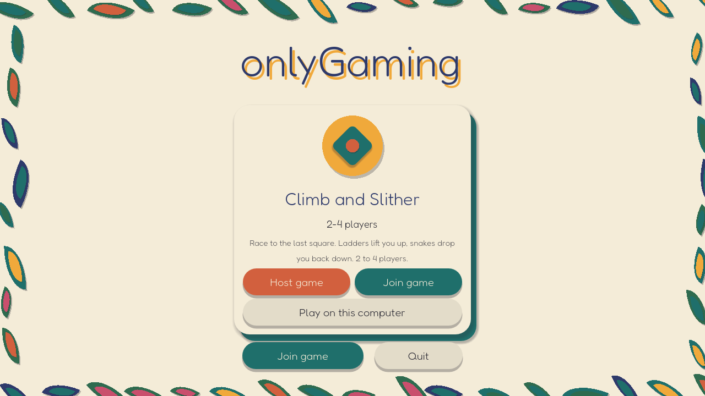
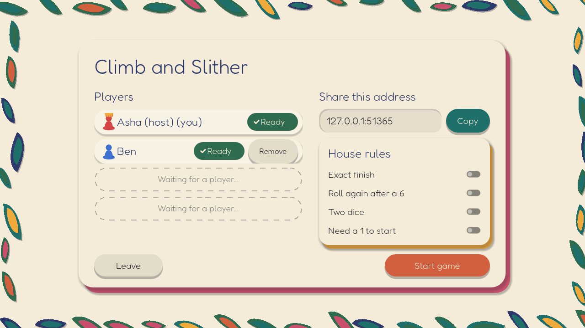
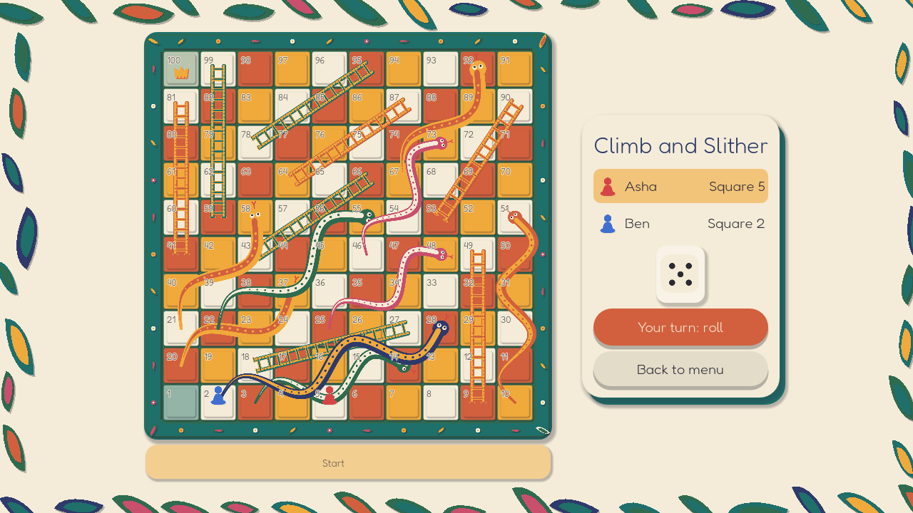
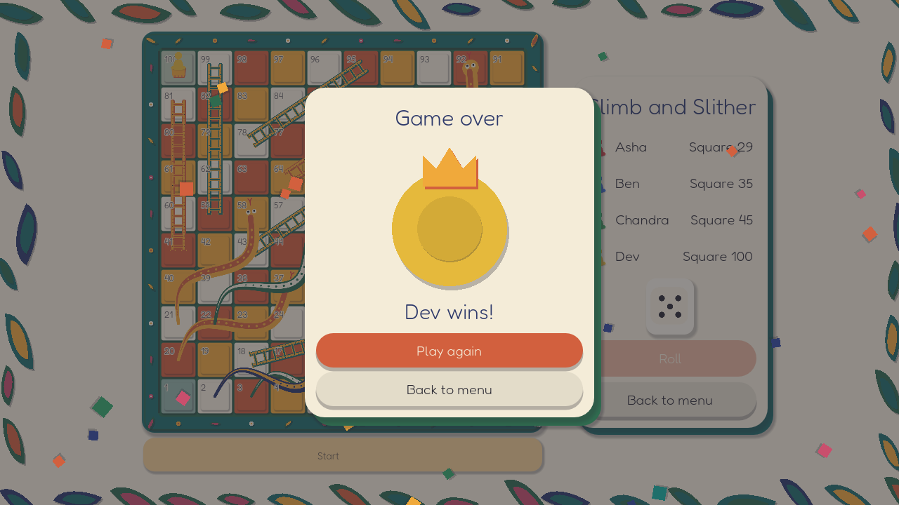

# onlyGaming

Free, open-source desktop board and card games to play with friends. One app, many games:
one player hosts, the others join. First game: **Climb and Slither** (a Snakes and Ladders game, 2+ players).

## What it looks like

**Home:** pick a game, then host, join, or play on one computer.



**Lobby:** the host shares the room code (or address), picks the house rules, and starts when everyone is ready. Guests see the rules read-only.



**Game:** roll on your turn; everyone's board updates together. The host decides what happens if a player drops (wait, continue, or remove them).



**Game over:** the host can play again or send everyone back to the lobby.



## Install

There are no ready-made downloads yet, so you run the game with Godot. Everyone who plays needs this part.

1. **Install Godot 4.7** (the standard build, not ".NET") from <https://godotengine.org/download>.
   - **Windows:** unzip it anywhere and run the `.exe`.
   - **macOS:** drag `Godot.app` to Applications. The first time, right-click it and choose Open.
2. **Get the game:** `git clone https://github.com/thelastone07/openGaming` (or download the ZIP from GitHub and unzip it).
3. **Run it:** open Godot, choose **Import**, select the `project.godot` file in the game folder, and press the play button (F5).
   - Command line instead: `godot --path <game folder>` (macOS: `/Applications/Godot.app/Contents/MacOS/Godot --path <game folder>`).

## Play

- **On one computer:** home screen, then **Play on this computer**.
- **Online:** one person **hosts**, the others **join** with a room code (see below). Everyone needs the same version of the game.
- **Same Wi-Fi without a relay:** in the Host screen choose "Host with: Direct address" and share the address it shows.

## Playing online: the host sets up the relay (once)

Friends reach you through a small relay that you run on a free Cloudflare account. **Only the host needs this**; guests install the game, paste the relay address, and type the room code you give them. You can reuse the same relay for every game you host.

**1. Make a free Cloudflare account**
- Go to <https://dash.cloudflare.com/sign-up>, sign up with an email and password, and confirm the email. No payment card is needed for the free plan.

**2. Install Node.js 22 or newer** (needed once, to publish the relay)
- **Windows:** the installer from <https://nodejs.org>.
- **macOS:** the installer from <https://nodejs.org>, or `brew install node`.

**3. Publish the relay** (a terminal: PowerShell on Windows, Terminal on macOS)
```
cd <game folder>/relay/cloudflare
npm install
npx wrangler login
npx wrangler deploy
```
- `wrangler login` opens a browser: log in and click **Allow**.
- On the first deploy it asks you to choose a **workers.dev subdomain** (for example `my-games`). Pick something you are happy to have in a web address.
- When it finishes it prints your **Workers URL**, like `https://onlygaming-relay.my-games.workers.dev`. You can also find it in the Cloudflare dashboard under **Workers & Pages**, then your worker.

**4. Use it in the game**
- Choose **Host game**. In the **Connection** box paste your Workers URL, press **Test** (it should say "The relay works"), then press **Host**.
- The lobby shows a 6-letter **room code**. Send friends the code **and the Workers URL**. They choose **Join game**, paste the URL into their Connection box, type the code, and join.

Good to know: the free plan allows about 100,000 relay requests a day, which is hundreds of game-hours, and a relay owner can read the game's messages, so only share your URL with people you trust. Details: [`docs/relay.md`](docs/relay.md).

## Docs

`CLAUDE.md` explains how the project is built. `docs/` has the rules, the networking design, the relay, and how to run the tests (`docs/running-tests.md`) and test online play (`docs/manual-network-test.md`).

## Release checklist

- [ ] Blank `onlygaming/network/relay_url` in `project.godot` before the repo goes public
      (it is the one committed default relay URL; players can still set their own in app settings).

## Credits

- **Fredoka** (text) — Copyright 2016 The Fredoka Project Authors, SIL Open Font License 1.1.
  `core/assets/fonts/OFL-fredoka.txt`
- **Baloo 2** (Devanagari and Vietnamese fallback for player names) — Copyright 2019 The Baloo 2
  Project Authors, SIL Open Font License 1.1. `core/assets/fonts/OFL-baloo2.txt`
- **GUT** test framework (`addons/gut`) — MIT licence.
- Snakes and Ladders is a traditional game with roots in India (Moksha Patam); this version uses
  original art and rules text.
